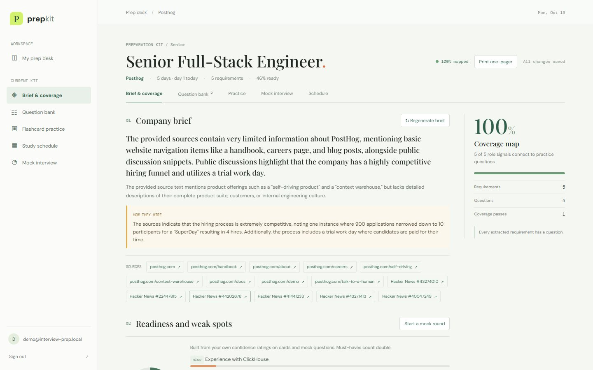
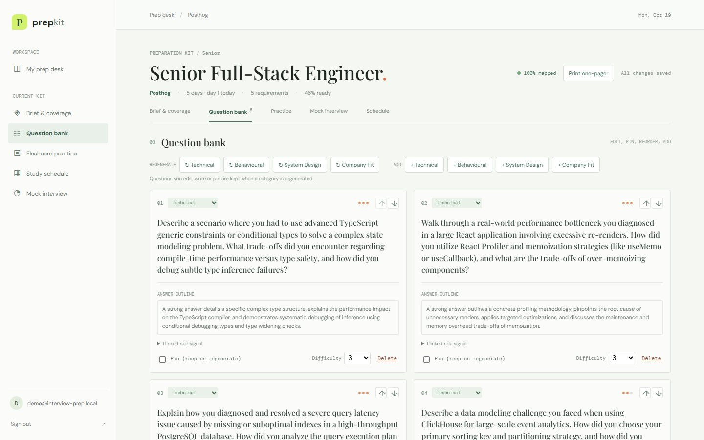
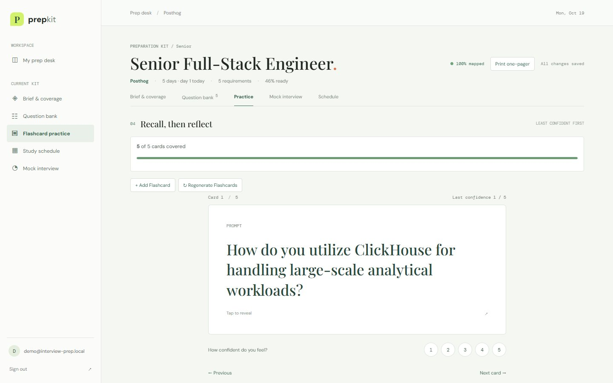
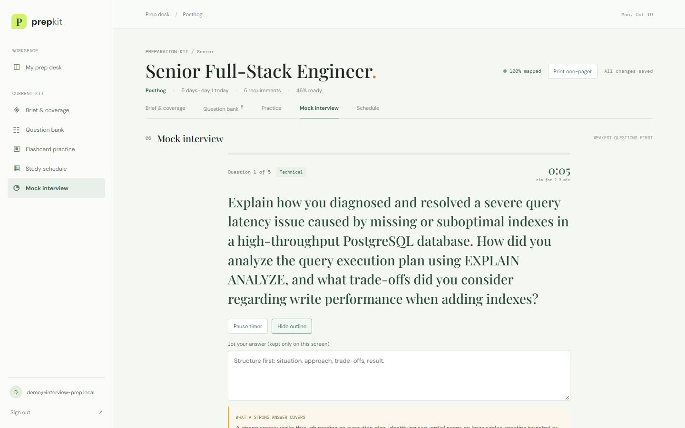
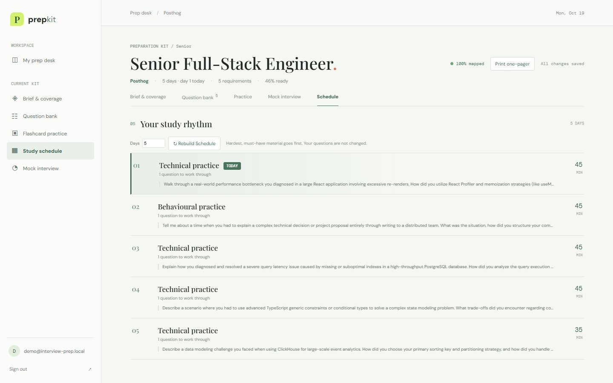
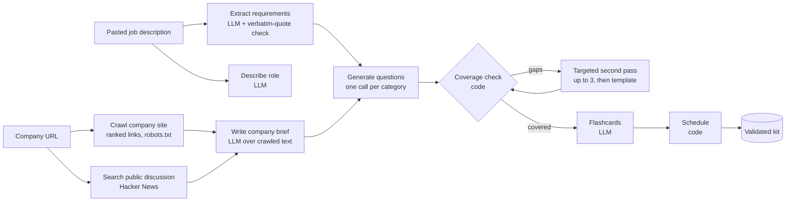

# Prep Kit: an AI interview preparation kit

**Paste a job description and a company website. Get a researched, editable, practisable preparation kit.**

[](https://trao-the-ai-interview-prep-kit.vercel.app)
[](https://trao-interview-prep-kit-api.onrender.com/api/health)




Prep Kit crawls the company's own site, looks for public discussion of how they interview, extracts what the posting actually asks for, and combines it all into a kit: a company brief, a role breakdown, a categorised question bank, flashcards and a day-by-day study schedule. Everything can be edited, reordered, pinned and regenerated section by section **without losing your work**, and you can practise inside the app.

## Deployment

| | Link | Hosting |
|---|---|---|
| **Web app** | https://trao-the-ai-interview-prep-kit.vercel.app | Vercel (free) |
| **API** | https://trao-interview-prep-kit-api.onrender.com | Render (free) |
| **API health** | https://trao-interview-prep-kit-api.onrender.com/api/health | reports `persistence: mongodb` |
| **Database** | MongoDB Atlas M0 | Atlas (free) |
| **Source** | https://github.com/Sathvik2005/Trao--The-AI-Interview-Prep-Kit | public |

Frontend and backend are deployed separately and both are publicly reachable. Sign in with an account you create on the sign-in screen (password of 12 or more characters). Render's free tier sleeps when idle, so the first request after a pause can take 30 to 60 seconds; open the health link first.

## What it does

| | |
|---|---|
| **Research that responds to what it finds** | Crawls the company site, ranks links by how likely they are to describe the business or hiring, follows a careers page one level deeper, honours `robots.txt`, and searches public interview discussion. What is found changes which questions are asked. |
| **Requirements you can trust** | Every requirement must carry a verbatim quote from the posting; anything the model cannot quote is dropped. `must` versus `nice` comes from the posting's own wording. |
| **Coverage checked by code** | Code, not the model, finds requirements with no question and sends only those back for a targeted second pass (up to three), then falls back to a plain question so no must-have ships uncovered. |
| **A builder that respects your edits** | Edit, add, delete, pin, reorder, and move questions between categories. Regenerate one category, the brief, the flashcards or the schedule; edited, hand-written and pinned items are kept. |
| **Practice** | Flashcards least-confident first, a timed **mock interview** round, a **readiness score** with your weakest requirements, and a schedule that follows the calendar ("Today: day 2 of 5"). |
| **Honest about gaps** | Dead site, no hiring page, a two-line posting, no public discussion: each yields a thin kit that says so, never an invented one. |
| **Batch mode** | `npm run evaluate` runs the same pipeline over a file of postings. |
| **Print one-pager** | Export the whole plan to a clean, printable page. |

## Screenshots

| Question bank | Practice |
|---|---|
|  |  |
| **Mock interview** | **Study schedule** |
|  |  |

## How it works



Two steps are deliberately **not** given to the model: coverage comparison and schedule allocation. They are arithmetic, and a model asked "is everything covered?" will simply say yes. See [docs/PIPELINE.md](docs/PIPELINE.md).

## Tech stack

| Layer | Choice | Why |
|---|---|---|
| Frontend | React 19, Vite, TypeScript, hand-written CSS | An authenticated single-page tool with no server-rendering need; fast builds and a static deploy. The brief prefers Next.js with Tailwind but allows equivalents. |
| Backend | Node 20+, Express, TypeScript | As specified. |
| Database | MongoDB (Atlas free tier) | As specified. An in-memory store is used for local development only. |
| LLM | Google Gemini (`gemini-flash-lite-latest`, fallback models), free tier | Genuine free tier, JSON mode, fast. Calls are retried, rate-limited and fall back across models. |
| Retrieval | `fetch` and a small HTML cleaner, Hacker News Algolia API | No paid search key needed. |
| Validation | Zod | One schema is the contract for the API, the batch CLI and the UI. |
| Tests | Vitest, Supertest | 28 tests; plus live end-to-end and real-browser checks. |
| Hosting | Vercel (frontend), Render (API), MongoDB Atlas | All free tiers. |

## Quick start

```bash
git clone https://github.com/Sathvik2005/Trao--The-AI-Interview-Prep-Kit.git
cd Trao--The-AI-Interview-Prep-Kit
npm ci
cp .env.example .env     # set GEMINI_API_KEY and a JWT_SECRET of 32+ characters
npm run dev              # API on :3000, web on :5173
```

`MONGODB_URI` is optional locally: leave it empty and the app uses an in-memory store (data resets on restart). Get a free Gemini key at https://aistudio.google.com/apikey.

| Command | Purpose |
|---|---|
| `npm run dev` | API and web together with reload |
| `npm run build` | Typecheck and build the web bundle |
| `npm test -- --run` | Run the test suite |
| `npm run typecheck` | Type-check only |
| `npm run evaluate -- --input <cases.json> --output <kits.json>` | Batch entry point |
| `npm start` | Run the API (production) |

### Batch entry point

```bash
npm run evaluate -- --input cases.json --output kits.json
```

Input: an array of `{ "id", "jd", "company_url", "days" }`. Output: `{ "version": "1.0", "generated_at", "kits": [{ "id", "status", "kit", "error" }] }`. Cases run with limited concurrency and one failing case never stops the run. `failed` is reserved for a case where no kit could be produced; a partly researched case is `ok` with its gaps recorded in `research_notes`. The command exits non-zero if any case failed. Only `GEMINI_API_KEY` is required, and company sites may be local addresses (relative links are followed). Verified from a fresh clone.

## Configuration

| Variable | Where | Purpose |
|---|---|---|
| `GEMINI_API_KEY` | API, CLI | LLM access. Required in production. Never sent to the browser. |
| `GEMINI_MODEL` | API, CLI | Primary model (default `gemini-flash-lite-latest`). |
| `GEMINI_FALLBACK_MODELS` | API, CLI | Comma-separated fallbacks (default `gemini-3-flash-preview,gemini-3.1-flash-lite`). |
| `GEMINI_CONCURRENCY` | API, CLI | Max in-flight model calls (default 2). |
| `MONGODB_URI` | API | Atlas connection string. Required in production. |
| `MONGODB_DATABASE` | API | Database name (default `interview_prep_kit`). |
| `JWT_SECRET` | API | Signs sessions; 32+ random characters. |
| `FRONTEND_ORIGIN` | API | Comma-separated browser origins allowed to call the API. |
| `VITE_API_URL` | Web build | Public URL of the API, baked into the frontend build. |
| `GENERATION_RATE_LIMIT` | API | Generations per IP per 15 minutes (default 30). |
| `TEST_EMAIL`, `TEST_PASSWORD` | API | Optional reviewer login created at boot (12+ character password). |
| `DNS_SERVERS` | API (local) | Override resolvers when a network blocks MongoDB SRV lookups. |
| `NODE_ENV`, `PORT` | API | Standard. `production` enables strict address checks. |

## How this meets the assessment brief

The project was built for the *Full-Stack Engineering Assessment: The AI Interview Prep Kit*. This is how each requirement is met; evidence is in [docs/E2E_REPORT.md](docs/E2E_REPORT.md) and the file-level mapping is in [docs/REQUIREMENTS_TRACEABILITY.md](docs/REQUIREMENTS_TRACEABILITY.md).

| Brief | What was asked | How it is met |
|---|---|---|
| **1 Authentication** | Register, log in, log out; own kits only; handle expired sessions | bcrypt passwords; 2-hour tokens whose hashes are stored server-side so logout revokes them; every query is owner-scoped; the UI clears an expired session with a message |
| **2 Input and research** | Pasted JD and company URL; several roles; crawl for what they do and how they hire; find public interview discussion; skip failed sources; rate-limit and back off | Form plus a JSON upload for several postings; ranked-link crawl with a one-level follow-up from careers pages; `robots.txt` honoured; Hacker News discussion search; 400 ms spacing and 429/503 backoff; every skipped source recorded in `research_notes` |
| **3 Research and generation** | A sequence of deliberate steps that respond to what was found; schedule and coverage not given to the model | Nine ordered steps (see the diagram above). Questions are generated per category, and a hiring-process mention of system design adds that category. Coverage and schedule are plain code |
| **4 The second pass** | After the first draft, find uncovered requirements and generate them; never ship uncovered must-haves | Code computes the gaps; only the missing requirements are sent back, up to three passes, then a template question. `coverage.passes` records it; **Close the gaps** in the UI runs the same pass on demand |
| **5 Kit structure** | Appendix A fields named exactly; stable ids; must or nice; integer minutes | Zod schema with cross-reference rules; extensions (`origin`, `pinned`, `hiring_process`, `research_notes`) are optional |
| **6 The builder** | Edit, reorder, move between categories, add, delete; regenerate one section without losing edits | All in the UI with autosave. The server marks each item `generated`, `edited` or `manual`; regeneration keeps edited, hand-written and pinned items and leaves other sections alone |
| **7 Practice mode** | Step through flashcards, record confidence, show covered and not covered, order by least confident | Flashcard practice (least confident first) with a covered and not-covered panel, plus a timed mock interview and a readiness score |
| **8 The schedule** | Exactly the requested days; every must-have present; harder material earlier; integer minutes | Pure code: must-have then hardest first, split into exactly N days; 15 + 10 x difficulty minutes per question |
| **9 Batch entry point** | `npm run evaluate -- --input --output`; same pipeline; continue after a failure; five cases in fifteen minutes; credentials from environment variables; runs from a clean clone | Verified from a fresh clone: 3 cases in 71 seconds with only `GEMINI_API_KEY` set; local company sites with relative links work; failures are isolated |
| **10 Edge cases** | Dead URL, no hiring page, two-line posting, no discussion, bad JSON, rate limits, duplicates, 1 and 60 days | Each yields an honest kit with the gap recorded, never an invented one; duplicate submissions return the existing kit; model errors retry across a model chain; 1 and 60 days both verified |
| **11 Security** | Validate URLs, reject private addresses in production, restrict content types and sizes, treat page text as data | Address guard re-checked after DNS and every redirect; text content types only; 1 MB cap; untrusted text is passed to the model as JSON data and the output is schema-validated |
| **12 Frontend** | Next.js and Tailwind (or equivalent); reusable components; loading, empty and error states; immediate edits; laptop, phone and keyboard | React, Vite and hand-written CSS (the stack difference is justified in [docs/DECISIONS.md](docs/DECISIONS.md)); step-by-step progress, skeletons, empty states, instant edits with debounced autosave; responsive layout; skip link and labelled controls |
| **13 Backend** | Node.js; separated concerns; validation; persistence; structured errors; slow generation | Express with layered modules; Zod validation; MongoDB; one error shape; generation runs as a job with polled progress and a clean failure state |
| **14 Code quality** | TypeScript or JavaScript; clean architecture; meaningful commits; tests for schedule, coverage and structure | Strict TypeScript; dependency direction web, API, pipeline, research and model, domain; 28 tests; commit history shows the development path |
| **Creative feature** (optional) | One feature that solves a real prep problem | Readiness and weak spots, mock interview, today's plan and a printable one-pager, explained below |
| **Deployment** (mandatory) | Public, frontend and backend both reachable, env vars documented, free tiers | See the Deployment table above and [docs/DEPLOYMENT_RUNBOOK.md](docs/DEPLOYMENT_RUNBOOK.md) |
| **Submission** | Public repository, deployment link, walkthrough video, README | This repository; links above; README covers every item the brief lists |

### Creative features

Interview prep fails in predictable places: people do not know where they are weak, never rehearse under time pressure, and lose track of the plan. Each feature reuses data the kit already holds.

- **Readiness and weak spots:** a score per requirement from your own confidence ratings (must-haves count double), shown as an overall ring and your three weakest requirements.
- **Mock interview:** a timed round over your weakest questions; think against the clock, peek at the outline only if stuck, then rate yourself. Ratings feed readiness.
- **Today's plan:** the schedule follows the calendar from the day the kit was created.
- **Printable one-pager:** the whole plan on one clean page for use away from a screen.

### What is deliberately different from the preferred stack

The brief prefers Next.js with Tailwind and allows equivalents with a justification. This app is an authenticated single-page tool with no server-rendering or SEO need, so it uses Vite, React and hand-written CSS with design tokens. Everything else (Node, Express, MongoDB, TypeScript, a free-tier model) is as specified.

## Documentation

| Document | What is in it |
|---|---|
| [Architecture](docs/ARCHITECTURE.md) | System context, components, data flow, state model, scaling |
| [Pipeline](docs/PIPELINE.md) | Research and generation step by step, retries, coverage loop, schedule maths |
| [API reference](docs/API.md) | Every endpoint, request, response and error |
| [Data model](docs/DATA_MODEL.md) | Kit schema (with extensions), MongoDB collections, provenance |
| [Security](docs/SECURITY.md) | Threat model and controls |
| [Deployment runbook](docs/DEPLOYMENT_RUNBOOK.md) | Atlas, Render, Vercel, and the failures actually hit |
| [Operations and handover](docs/OPERATIONS.md) | Running it, monitoring, secrets, costs, incident checklist |
| [Development guide](docs/DEVELOPMENT.md) | Layout, conventions, testing, troubleshooting |
| [Design decisions](docs/DECISIONS.md) | The choices and trade-offs, in decision-record form |
| [Test report](docs/TEST_REPORT.md), [E2E report](docs/E2E_REPORT.md) | What was verified and how |
| [Requirements traceability](docs/REQUIREMENTS_TRACEABILITY.md), [Known issues](docs/KNOWN_ISSUES.md) | Brief mapping; limitations |

## Project layout

```
src/
  domain/      schema, validation, coverage, schedule, requirement grounding, reconcile and provenance (pure)
  research/    company crawl, link ranking, robots.txt, address safety, public-discussion search
  llm/         Gemini client (retry, fallback, cooldown) and the separately prompted generation steps
  pipeline/    generateInterviewKit and regenerateSection
  api/         Express routes, auth, background jobs, MongoDB and in-memory stores
  cli/         batch entry point
  web/         React UI
test/          domain, pipeline, regeneration, API and batch tests
docs/          documentation
```

## Quality

- **28 automated tests** cover schedule allocation, coverage, schema validation, requirement grounding, regeneration preserving edits, research behaviour, the API and the batch contract.
- **Live end-to-end** against Atlas, real Gemini, posthog.com and Hacker News: 28 of 28 checks pass, about 25 seconds per kit.
- **Real-browser checks** (headless Chrome) against the deployed site: edit autosave, regeneration that keeps your edit, persistence after reload, mock round, print sheet, sign-out.
- **Security:** private-address blocking with DNS and redirect checks, size and content-type limits, page text treated strictly as data, hashed passwords, revocable sessions, owner-scoped queries. `npm audit` on production dependencies reports 0 vulnerabilities.

## Known limitations

Job progress lives in memory on one API instance; public discussion comes only from Hacker News; the crawler reads server-rendered HTML; the UI is a single large module that would be split as it grows; question quality depends on a free-tier model. The full list is in [docs/KNOWN_ISSUES.md](docs/KNOWN_ISSUES.md).

## Author

Built by Sathvik ([@Sathvik2005](https://github.com/Sathvik2005)). AI coding assistance was used throughout; every design decision above was reviewed and verified against running code.
