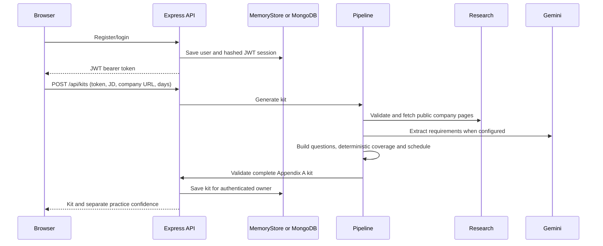

# Architecture

## Runtime components

- `src/web/main.tsx`: React SPA for account access, kit creation, saved kits, question editing/reordering, schedule viewing, and flashcard confidence practice.
- `src/api/app.ts`: Express API, validation, CORS, JWT authentication, rate limits, kit ownership and request error mapping.
- `src/api/store.ts`: MongoDB store for production/persistent local operation.
- `src/api/memory-store.ts`: nonpersistent fallback when `MONGODB_URI` is blank; intended for local demo and tests only.
- `src/pipeline/generate-kit.ts`: shared generator called by API and batch CLI.
- `src/research/company-research.ts`: company page research and public discussion search.
- `src/llm/gemini-requirements.ts`: optional Gemini requirement extraction with quoted-evidence checks.
- `src/domain/*`: strict Appendix A schema, requirement IDs, deterministic coverage and schedule logic.
- `src/cli/evaluate.ts`: Appendix B-compatible batch runner.

## Request flow

## Persistence and trust boundaries

MongoDB stores users, revocable hashed JWT sessions, and kit documents. Practice confidence is separate from the Appendix A `kit` object. MongoDB indexes are created on startup. In-memory mode supports local operation without Docker/MongoDB but resets on process restart.

Passwords use bcrypt. Access tokens are short-lived JWT bearer tokens; only their SHA-256 hashes are stored for revocation. The browser stores the token in `sessionStorage`. All kit reads/writes are scoped to the authenticated owner. Generated and edited content is schema-validated before persistence.

Production company fetches reject private/reserved address targets, limit redirects, body size, content types, and request duration. DNS results are checked but not pinned to the network connection, so DNS rebinding remains a residual risk. `robots.txt` and terms are not currently enforced.
