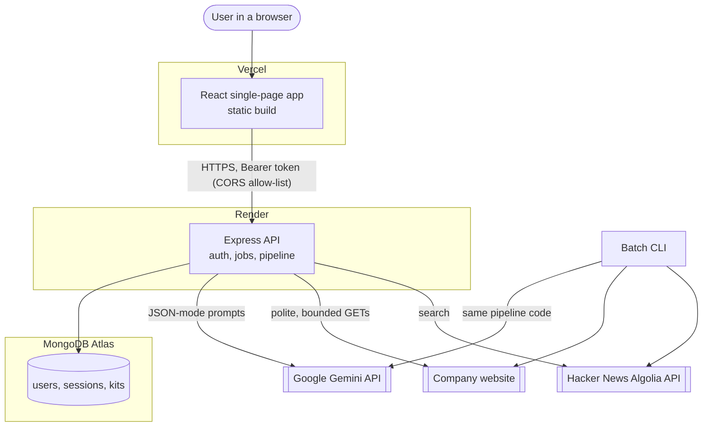
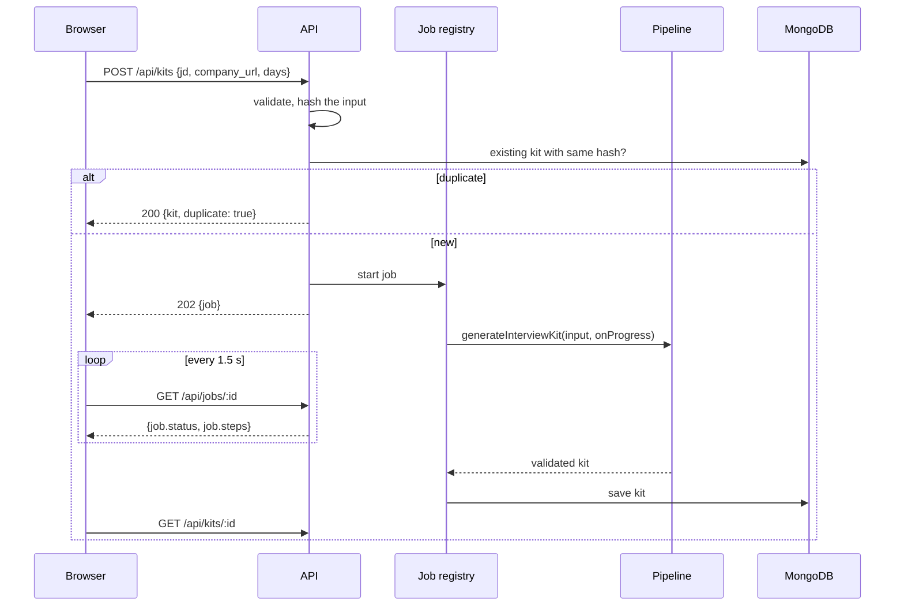
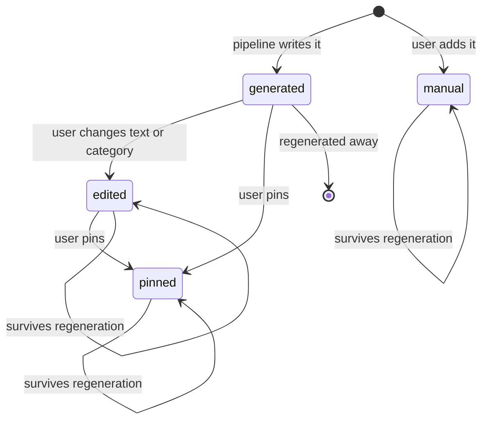

# Architecture

## 1. System context

The frontend and backend are deployed separately and meet only over HTTPS. The batch CLI imports the **same pipeline module** as the API; it is not a parallel implementation.

## 2. Components

| Component | Location | Responsibility | Depends on |
|---|---|---|---|
| Domain | `src/domain/` | Kit schema and cross-reference validation, coverage analysis, schedule allocation, requirement grounding, derived-field reconciliation and provenance. Pure functions, no I/O. | Zod |
| Research | `src/research/` | Crawl a company site, rank links, honour `robots.txt`, guard against unsafe addresses, search public discussion. Never throws on an unreachable site; returns notes. | `fetch`, `ipaddr.js` |
| LLM | `src/llm/` | Gemini client (retry, fallback, cooldown, concurrency cap) and one function per prompted step, each validated by Zod. | Domain types |
| Pipeline | `src/pipeline/` | Orchestrates the steps in order (`generateInterviewKit`) and rebuilds one section (`regenerateSection`). | Domain, Research, LLM |
| API | `src/api/` | Routes, authentication, rate limits, background jobs, persistence behind a `DatabaseStore` interface (MongoDB and in-memory implementations). | Pipeline, Domain |
| CLI | `src/cli/evaluate.ts` | Batch entry point; calls `generateInterviewKit` per case. | Pipeline |
| Web | `src/web/` | React UI: auth, dashboard, progress, builder, practice, mock interview, schedule, print sheet. | API over HTTP |

Dependency direction is one-way: web → API → pipeline → (research, llm) → domain. Domain imports nothing from the other layers, which is why the rules that matter (coverage, schedule, validity) are cheap to test.

## 3. Request flow: building a kit

Generation takes roughly 10 to 90 seconds and can fail partway. Returning a job id immediately keeps requests short and lets the UI show step-by-step progress. Nothing is saved unless the whole kit validates.

## 4. Pipeline summary

See [PIPELINE.md](PIPELINE.md) for detail.

1. Extract requirements (LLM; code verifies quotes).
2. Describe the role (LLM).
3. Research the company (code): crawl and discussion search.
4. Write the brief (LLM over crawled text).
5. Generate questions, one call per category (LLM).
6. Coverage check and second pass (code decides, LLM fills).
7. Flashcards (LLM).
8. Schedule (code).
9. Validate (Zod plus cross-reference rules).

## 5. State model: generated, edited, pinned

Each question and flashcard carries `origin` (`generated`, `edited`, `manual`) and an optional `pinned` flag. The **server** assigns `origin` on every save by comparing the incoming kit with the stored one, so a client cannot forget to mark an edit. A section regeneration removes only items that are `generated` **and** not pinned in the affected category, and passes the kept prompts to the model so it does not repeat them. Afterwards `reconcileKit` repairs the derived parts: stale ids leave the schedule, new questions join the lightest day, minutes and coverage are recomputed.

## 6. Persistence

MongoDB holds three collections (`users`, `sessions`, `kits`); see [DATA_MODEL.md](DATA_MODEL.md). Kits are stored as one document containing the whole kit plus a `practice` array of confidence ratings. The `DatabaseStore` interface lets the in-memory implementation back local development and the test suite with identical behaviour.

## 7. Authentication

Passwords are hashed with bcrypt. Login returns a JWT (2 hours). The hash of each token is stored server-side with a TTL index, so **logout revokes the token** and expired sessions are removed automatically. Every kit query includes the owner's id. See [SECURITY.md](SECURITY.md).

## 8. Failure handling

| Failure | Behaviour |
|---|---|
| Company site unreachable, 404, timeout, blocked by `robots.txt` | Recorded in `research_notes`; kit still produced with an honest brief |
| Public discussion not found | Recorded; hiring section left empty |
| Model 429/503/timeout | Retried with backoff, then the next model in the chain; a failing model is cooled down for 45 s |
| Model returns unexpected shape | Tolerant parsing; otherwise the category is retried by the coverage loop |
| Requirement without a question after 3 model passes | Plain template question and a note |
| Browser edit that breaks a rule (for example removes the only question for a must-have) | Rejected with a 400 and a readable message |
| Backend restart during generation | Progress view lost; kit not saved (retry from the UI) |

## 9. Scaling and limits

- The API is stateless except for the in-memory job registry. One instance is assumed; to run several, move job state into MongoDB (the `GenerationJob` shape is already serialisable).
- Model concurrency is capped per process (default 2); free-tier rate limits are the practical ceiling.
- Per-user limits: 2 running generations, 30 generations per IP per 15 minutes, 20 auth attempts per 15 minutes.
- Cost: free tiers for hosting and the model. Each kit makes about 7 to 10 model calls.

## 10. Frontend structure

`src/web/main.tsx` contains the app shell, auth screen, dashboard, job cards, the kit workspace (overview, question bank, practice, mock interview, schedule) and the print sheet. State is local React state with the server as the source of truth; edits update local state immediately and save after a short debounce, and only server-derived fields (schedule, coverage, provenance) are merged back so typing is never overwritten. The file is large and is the first candidate for splitting into per-view modules.
